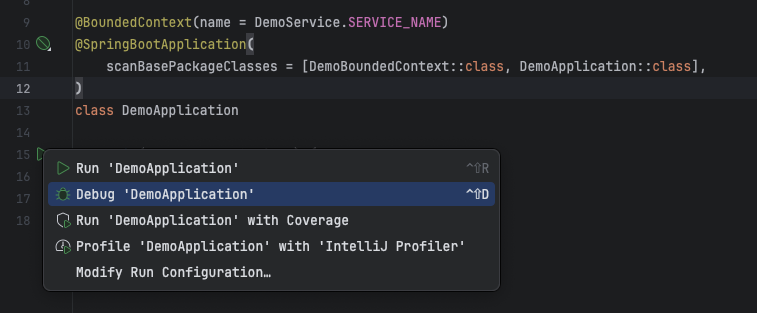
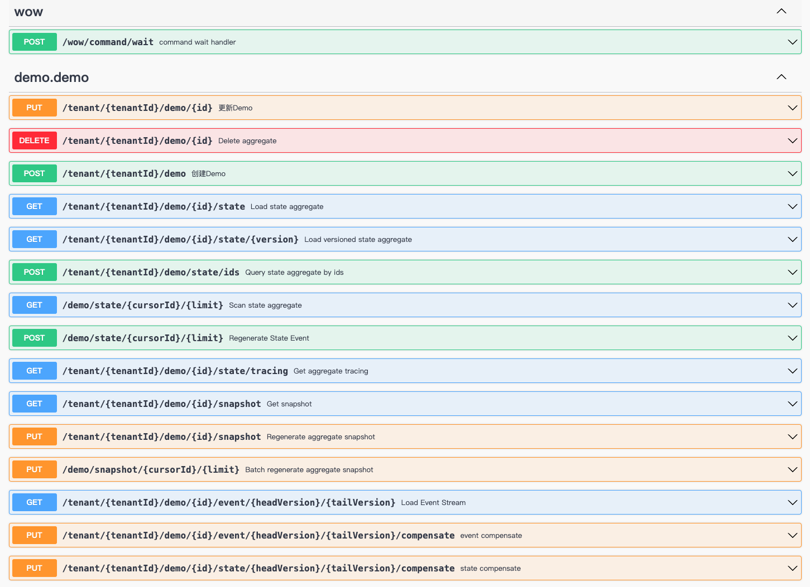
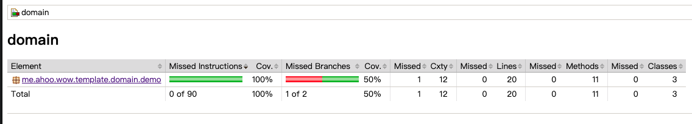
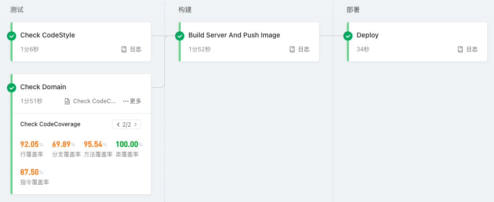
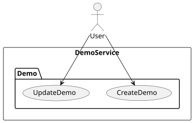

# 基于 Wow 框架的 DDD 项目模版

[](https://codecov.io/gh/Ahoo-Wang/wow-project-template)
[](https://deepwiki.com/Ahoo-Wang/wow-project-template)

用于快速构建基于 [Wow 框架](https://github.com/Ahoo-Wang/Wow) 的 DDD 项目模板。

> [!WARNING]
> 本模板基于 **Wow 10.0.0-beta.18**（预发布版）：API、配置、存储与线上格式在 10.0.0 GA 前仍可能变化，不承诺兼容，不建议用于生产。
> 9.x 稳定版模板见 Git 历史中 Wow 9.9.0 的版本；从 9.x 迁移请参考 Wow 文档《Migrating from 9.x》与 `wow-migrate` Skill。

## 模块介绍

| 模块                                              | 说明                                                                                                                                                            |
|-------------------------------------------------|---------------------------------------------------------------------------------------------------------------------------------------------------------------|
| [api](./api)                                    | **API 层**（`me.ahoo.wow.api` 插件），定义聚合命令（Command）与领域事件（Domain Event），充当上下文的“发布语言”。插件从 domain 装配契约并生成 `DemoContract`（聚合类型、错误码、等待跳点、查询字段）与状态视图 `DemoStateView`；其他服务只依赖本模块即可调用本服务（Wow 的 `CommandClient` / `QueryApi`），无需手写客户端。 |
| [domain](./domain)                              | **领域层**（`me.ahoo.wow` 插件，KSP），包含聚合根、状态、错误码与 Saga。编译器在构建期生成模型工厂、处理器绑定与 Manifest 片段，运行时不做反射扫描。 |
| [server](./server)                              | **宿主服务**（`me.ahoo.wow.service` 插件），Spring Boot WebFlux 应用的启动点。路由由 Manifest 派生，无需控制器；构建合并服务的 Manifest、生成 OpenAPI，并以提交的 `manifest/baseline.json` 校验契约兼容性。提供 Docker 镜像与 Kubernetes 部署文件。 |
| [client](./client)                              | **客户端库**，由 [wow-generator](https://github.com/Ahoo-Wang/Wow) 根据服务的 Manifest 基线生成的 TypeScript 客户端（基于 `@ahoo-wang/wow-client`），每个聚合一套命令、快照查询、事件查询与状态客户端，含错误码与等待计划类型。 |
| [code-coverage-report](./code-coverage-report)  | **测试覆盖率**，用于生成详细的测试覆盖率报告，以及验证覆盖率是否符合要求。帮助开发团队了解项目测试的全面性和质量。                                                                                                   |
| [dependencies](./dependencies)                  | **依赖项管理**，这个模块负责管理项目的依赖关系，确保各个模块能够正确地引用和使用所需的外部库和工具。                                                                                                          |
| [bom](./bom)                                    | **项目的 BOM（Bill of Materials）**                                                                                                                                |
| [build-logic](./build-logic)                    | **构建约定插件**，统一各模块的工具链、编译选项、测试、静态检查、覆盖率与发布配置（`wow.*-conventions`）。 |
| [libs.versions.toml](gradle/libs.versions.toml) | **依赖版本配置文件**，明确了项目中各个库的版本，方便团队协作和保持版本的一致性。                                                                                                                    |
| [deploy](./deploy)                              | **Kubernetes 部署文件**，提供了在 Kubernetes 上部署应用程序所需的配置文件，简化了部署过程。                                                                                                   |
| [Dockerfile](server/Dockerfile)                 | **server Docker 构建镜像**，通过 Dockerfile 文件定义了应用程序的容器化构建步骤，方便部署和扩展。                                                                                               |
| [document](document)                            | **项目文档**，包括 UML 图和上下文映射图，为团队成员提供了对整个项目结构和业务逻辑的清晰理解。                                                                                                           |

## 创建项目

[](https://github.com/new?template_name=wow-project-template&template_owner=Ahoo-Wang)

点击上方按钮，基于 [Wow 项目模板](https://github.com/Ahoo-Wang/wow-project-template) 创建新仓库，然后克隆到本地即可开始编写领域模型。

- 修改 `settings.gradle.kts` 文件，将 `rootProject.name` 修改为项目名称
- 修改 `domain/{package}/DemoBoundedContext` 的上下文名（路由、事件名、主题与表名都以它为前缀，确定后不宜再改）
- 修改 `domain/build.gradle.kts` 的 `wow { contractPackage; service }` 与 `server` 的 `spring.application.name`（二者必须一致）
- 契约变化后执行 `./gradlew server:updateWowManifestBaseline` 记录基线，再在 `client/` 执行 `pnpm generate`

## Git

```shell
git init
git remote add origin <your-repo-url>
# 如果远端仓库有内容，需要先拉取
git pull origin master
# gradlew 脚本被注释，需要重新从模板项目中Copy过来
chmod +x gradlew
# 清理构建目录
gradle clean
git add .
git commit -m "Initial commit"
# 推送到远端仓库
git push -u origin master
```

## 启动服务

需要 JDK 21（生产运行建议 JDK 25）。未配置后端时，本机运行以内存保存数据、内部端口只绑定回环地址并以匿名调用方提供服务，开箱即用。本地开发建议启用 `dev` profile（调试日志、完整 actuator 端点，调用方由 `Wow-User` 等开发身份请求头声明）：

```shell
./gradlew server:run --args='--spring.profiles.active=dev'
```

```shell
curl -X POST http://localhost:8080/demo/demo/create-demo -H 'Content-Type: application/json' -d '{"data":"hello"}'
```

> 发行版（`server:installDist`）以 jar 内 `application.yaml` 为基线，`config/application.yaml` 用于环境覆盖。
> 部署到 Kubernetes 时节点需要后端（`wow-postgres` / `wow-mongo`）与认证调用方的 `CallerResolver`（如 `wow-cosec`），否则拒绝启动。

<p align="center" style="text-align:center">
  
</p>

> 访问：[http://localhost:8080/swagger-ui.html](http://localhost:8080/swagger-ui.html)

<p align="center" style="text-align:center">
  
</p>

## 使用客户端

客户端库提供类型安全的 API 调用接口，支持命令和查询操作。

1. **生成客户端代码**（读取提交的 `server/manifest/baseline.json`，无需启动服务端）：

   ```shell
   cd client
   pnpm install
   pnpm generate
   ```

2. **构建客户端库**：

   ```shell
   pnpm build
   ```

3. **在项目中使用**：

   ```typescript
   import { Fetcher } from '@ahoo-wang/fetcher';
   import { DemoClient } from '@ahoo-wang/wow-template-client';

   const demo = new DemoClient({ fetcher: new Fetcher({ baseURL: 'http://localhost:8080' }) });
   // 发送命令（默认等待到快照写入）
   const result = await demo.demo.commands.createDemo({ data: 'hello' });
   // 读取状态
   const snapshot = await demo.demo.state.get(result.ref.id);
   ```

   详细使用说明请参考 [client/README.md](./client/README.md)。

## 验证测试覆盖率

```shell
./gradlew domain:koverVerify
```

> 覆盖率门禁（domain ≥ 80%）已接入 `check`，`./gradlew build` 时自动执行。查看报告：`./gradlew domain:koverHtmlReport` 后打开 `domain/build/reports/kover/html/index.html`

<p align="center" style="text-align:center">
  
</p>

## CI/CD 流水线

<p align="center" style="text-align:center">
  
</p>

### 测试阶段

> 代码风格检查(Check CodeStyle)

```shell
./gradlew detekt
```
> 领域模型单元测试 (Check Domain)

```shell
./gradlew domain:check
```
> 测试覆盖率验证(Check CodeCoverage)

```shell
./gradlew domain:koverVerify
```
### 构建阶段

> 生成部署包 (Build Server)

```shell
./gradlew server:installDist
```

> 发布 Docker 镜像 (Push Image)

[Dockerfile](server/Dockerfile)

```shell
docker login --username=<username> --password=<******> <registry>
docker build -t <registry>/<image>:<tag> server
docker push <registry>/<image>:<tag>
```

### 部署阶段

> 部署到 Kubernetes (Deploy Kubernetes)

[deploy](./deploy)

```shell [部署到 Kubernetes (Deploy Kubernetes)]
kubectl apply -f deploy
```

### 流水线配置（阿里云效）

```yaml
sources:
  repo:
    type: codeup
    name: Wow 项目模板代码源
    endpoint: <your-project-repo>
    branch: main
    certificate:
      type: serviceConnection
      serviceConnection: <your-service-connection-id>
stages:
  test:
    name: "测试"
    jobs:
      code_style:
        name: "Check CodeStyle"
        runsOn: public/cn-hongkong
        steps:
          code_style:
            name: "代码风格检查"
            step: "JavaBuild"
            runsOn: public/
            with:
              jdkVersion: "17"
              run: ./gradlew detekt

      test:
        name: "Check Domain"
        runsOn: public/cn-hongkong
        steps:
          test:
            name: "Check Domain"
            step: "GradleUnitTest"
            with:
              jdkVersion: "17"
              run: ./gradlew domain:check
              reportDir: "domain/build/reports/tests/test"
              reportIndex: "index.html"
          coverage:
            name: "Check CodeCoverage"
            step: "JaCoCo"
            with:
              jdkVersion: "17"
              run: ./gradlew domain:koverVerify domain:koverHtmlReport
              reportDir: "domain/build/reports/kover/html"
  build:
    name: "构建"
    jobs:
      build:
        name: "Build Server And Push Image"
        runsOn: public/cn-hongkong
        steps:
          build:
            name: "Build Server"
            step: "JavaBuild"
            with:
              jdkVersion: "17"
              run: ./gradlew server:installDist
          publish_image:
            name: "Push Image"
            step: "ACRDockerBuild"
            with:
              artifact: "image"
              dockerfilePath: "server/Dockerfile"
              dockerRegistry: "<your-docker-registry—url>"
              dockerTag: ${DATETIME}
              region: "cn-hangzhou"
              serviceConnection: "<your-service-connection-id>"
  deploy:
    name: "部署"
    jobs:
      deploy:
        name: "Deploy"
        runsOn: public/cn-hongkong
        steps:
          deploy:
            name: "Deploy"
            step: "KubectlApply"
            with:
              skipTlsVerify: false
              kubernetesCluster: "<your-kubernetes-id>"
              useReplace: false
              namespace: "dev"
              kubectlVersion: "1.22.9"
              yamlPath: "deploy"
              skipVariableVerify: false
              variables:
                - key: IMAGE
                  value: $[stages.build.build.publish_image.artifacts.image]
                - key: REPLICAS
                  value: 2
                - key: SERVICE_NAME
                  value: "<service-name>"
```

## 设计文档

### 用例图

<p align="center" style="text-align:center">
  
</p>
