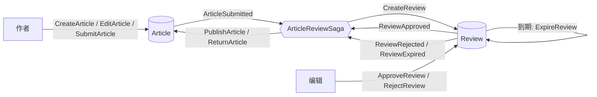

# Wow 服务模板

[](https://codecov.io/gh/Ahoo-Wang/wow-project-template)
[](https://deepwiki.com/Ahoo-Wang/wow-project-template)

一个按 [Wow](https://github.com/Ahoo-Wang/Wow) 10 最佳实践组织的 DDD + 事件溯源 + CQRS 服务模板：拿到即可运行、测试、部署，
再把示例领域换成你自己的。

> [!WARNING]
> 本模板基于 **Wow 10.0.0-beta.22**（预发布版）：API、配置、存储与线上格式在 10.0.0 GA 前仍可能变化，不承诺兼容，不建议用于生产。

## 设计原则

1. **模板是起点。** 每个文件要么是你保留的基础设施，要么是要替换的示例。示例里每种实践只出现一次，并且都有测试。
2. **照 Wow 的约定。** 模块角色、Gradle 插件、命名、测试 DSL、部署方式都与 Wow 文档一致，偏离之处写明理由。
3. **构建最小化。** 版本只在 [`gradle/libs.versions.toml`](gradle/libs.versions.toml) 声明一次，构建逻辑只在 [`build-logic`](build-logic) 中；只发布别的服务需要的 `blog-api`。
4. **正确性有门禁。** 编译与 KSP、领域与服务测试、detekt、覆盖率、Manifest 兼容性、真实存储上的集成测试、TS 客户端漂移、发行版冒烟、Helm values 校验，全部在 CI 中执行。
5. **生产路径显式。** 存储（MongoDB）、调用方认证（CoSec 网关）、部署（Wow 的 Helm chart）、可观测性（OpenTelemetry）都有默认答案；本地开发不依赖任何外部服务。

## 示例领域：博客

作者撰写文章、提交审核；编辑批准或驳回；审核 Saga 协调两个聚合；审核超时未裁决则自动退回作者。



| Wow 实践 | 示例中的位置 |
|---|---|
| 命令形状用 Jakarta 约束，在准入时校验（400 `wow.command.invalid`） | [`ArticleCommands.kt`](api/src/main/kotlin/me/ahoo/wow/template/api/article/ArticleCommands.kt) |
| 业务规则用 `reject` + `@ErrorCode`，状态冲突用 409 | [`Article.kt`](domain/src/main/kotlin/me/ahoo/wow/template/domain/article/Article.kt) `Rejections` |
| 唯一键：`DecideScope.reserve` / `release`，租户内唯一 | `Article` 创建时预留 slug，删除时释放，恢复时重新预留（被占用则拒绝恢复） |
| 什么也不改变时返回 `null`（no-op） | `EditArticle`、`ExpireReview` |
| 所有权：文章属于作者（默认 `Ownership.OWNER`），审核属于租户（`Ownership.TENANT`） | [`Review.kt`](domain/src/main/kotlin/me/ahoo/wow/template/domain/review/Review.kt) |
| 内部命令 `@InternalCommand`：公开端口没有路由 | `CreateReview`、`PublishArticle`、`ReturnArticle`、`ExpireReview` |
| 领域服务注入命令函数 | [`ReviewPolicy`](domain/src/main/kotlin/me/ahoo/wow/template/domain/review/ReviewPolicy.kt)，由 `blog.review.timeout` 配置 |
| 持久化的定时命令：`schedule` / `cancelSchedule` | `Review` 开启时安排过期，裁决时取消 |
| Saga：类型化处理函数、确定性派生、`@OnRejected` 用 `rejected.accept(<codes>)` 只接受预期内的拒绝 | [`ArticleReviewSaga.kt`](domain/src/main/kotlin/me/ahoo/wow/template/domain/review/ArticleReviewSaga.kt)：审核期间文章被删除，发布被拒绝时接受；其他拒绝照常停放 |
| 溯源函数读取提交的时间，而不是系统时钟 | [`ArticleState`](domain/src/main/kotlin/me/ahoo/wow/template/domain/article/ArticleState.kt) 的 `publishedAt` |
| 快照查询索引 `@QueryIndex` | `ArticleState` 的 `slug`、`status` + `publishedAt` |
| 命令授权 `CommandAuthorizer`，运维命令用 `CommandAuthorizer.operational` | [`BlogAuthorization.kt`](server/src/main/kotlin/me/ahoo/wow/template/server/BlogAuthorization.kt)：只有编辑（`caller.hasRole`）能裁决审核、发送运维命令 |
| 收窄生命周期命令 `@AggregateRoot(lifecycle = [...])`，领域命令产出 `AggregateDeleted` / `AggregateRestored` | 文章用 `DeleteArticle` 删除并释放 slug，用 `RestoreArticle`（`@OnCommand(onDeleted = true)`）恢复并重新预留 slug，审核中删除的文章不能恢复；审核不开放任何生命周期命令，没人能删掉它而让文章卡在审核中 |

## 模块

```text
api/      (blog-api)     me.ahoo.wow.api      命令、事件、值类型；生成 BlogContract 与状态视图。唯一发布的制品
domain/   (blog-domain)  me.ahoo.wow          聚合、状态、错误码、Saga；KSP 生成模型。不依赖 Spring 与存储
server/   (blog-server)  me.ahoo.wow.service  Spring Boot 宿主、授权、配置；Manifest 基线、Helm values、集成测试、Dockerfile
client/                                       由 Manifest 基线生成的 TypeScript 客户端
deploy/                                       wow-service Helm chart 的应用侧 values
build-logic/                                  约定插件：wow.kotlin / wow.api / wow.domain / wow.server / wow.coverage
```

括号里是 Gradle 项目名（见 [`settings.gradle.kts`](settings.gradle.kts)）。Manifest 片段、绑定索引和发布的制品都以项目名命名，带上服务前缀，就不会与同一类路径上其他服务的模块冲突。

其他服务只依赖 `blog-api`，用 Wow 的 `CommandClient` / `QueryApi` 调用本服务（在 `wow.peers` 中登记），不需要手写客户端。

## 快速开始

需要 JDK 21。集成测试另需 Docker，客户端需要 Node.js 24 与 pnpm。

```bash
./gradlew :blog-server:run
```

`./gradlew :blog-server:run` 会自动启用 `dev` profile：内部端口只绑定 `127.0.0.1`，没有配置存储就以内存运行，调用方由开发身份请求头声明，`Wow-User` 是 subject，`Wow-Owner` 是 owner，`Wow-Roles` 是角色。运行发行版时用 `bin/blog-server --spring.profiles.active=dev`。

```bash
# 作者 alice 创建并提交文章；等待计划跟着审核 Saga，一直等到审核写入快照，回答中的 ref 就是这次审核
curl -X POST localhost:8080/blog/article/hello-wow/create-article -H 'Content-Type: application/json' \
  -H 'Wow-User: alice' -H 'Wow-Owner: alice' \
  -d '{"title":"Hello, Wow","body":"Event sourcing, step by step.","slug":"hello-wow"}'
curl -X POST localhost:8080/blog/article/hello-wow/submit-article -H 'Content-Type: application/json' \
  -H 'Wow-User: alice' -H 'Wow-Owner: alice' -H 'Wow-Wait: handled(ArticleReviewSaga.onArticleSubmitted)>snapshot' -d '{}'

# 编辑 erin 批准审核（把 <review-id> 换成上一步回答中的 ref.id）
curl -X POST localhost:8080/blog/review/<review-id>/approve-review -H 'Content-Type: application/json' \
  -H 'Wow-User: erin' -H 'Wow-Roles: editor' -H 'Wow-Wait: handled(ArticleReviewSaga.onReviewApproved)>snapshot' \
  -d '{"comment":"LGTM"}'

# 读取文章状态；按状态列出文章（走 @QueryIndex）
curl localhost:8080/blog/article/hello-wow/state -H 'Wow-User: alice' -H 'Wow-Owner: alice'
curl -X POST localhost:8080/blog/article/snapshot/query -H 'Content-Type: application/json' -H 'Wow-User: erin' -H 'Wow-Roles: editor' \
  -d '{"kind":"list","filter":{"op":"eq","field":"state.status","value":"PUBLISHED"},"limit":20}'
```

路由文档见 [http://localhost:8080/swagger-ui.html](http://localhost:8080/swagger-ui.html)，Manifest 见 `GET /wow/manifest`。

### 运行方式

| profile | 存储 | 调用方 | 用途 |
|---|---|---|---|
| `dev` | 内存（没有配置存储时） | 开发身份请求头 | 本地开发：`./gradlew :blog-server:run` 自动启用 |
| `mongo` | MongoDB 副本集（`spring.mongodb.uri`） | — | 真实存储，可与 `dev` 或 `cosec` 组合 |
| `cosec` | — | CoSec 网关转发的 `CoSec-Identity` | 生产：服务在 CoSec 网关之后，编辑是租户级调用方 |

不启用 `dev` profile 时（包括 Kubernetes 与任何虚拟机），节点必须有存储和调用方认证，否则拒绝启动，不会意外以内存或匿名方式运行。

## 开发流程

1. **先写测试。** 领域规则用 `aggregateSpec` / `sagaSpec` 在内存中测试（[`domain/src/test`](domain/src/test)），不需要 Spring 与存储。
2. **再写模型。** 命令、事件写在 `api`，聚合、状态、Saga 写在 `domain`。新聚合只需 `@AggregateRoot`，无需登记。
3. **契约变化。** 服务模块的 `check` 会比对 Manifest 与 [`server/manifest/baseline.json`](server/manifest/baseline.json)：
   - 有意的变更，执行 `./gradlew :blog-server:updateWowManifestBaseline` 记录基线，并在评审时审阅它的 diff。
   - 破坏兼容的变更会被拒绝记录：保持契约（`@Revision` + `@Upgrade`、`retiredEvents`），或者提升服务的主版本。
4. **重新生成客户端。** 在 `client/` 执行 `pnpm generate`，提交 `src/generated`。

```bash
./gradlew build                                   # 编译、KSP、测试、detekt、覆盖率门禁、Manifest 兼容性
./gradlew :blog-domain:test --tests "*ArticleSpec" # 只跑一个领域 spec
./gradlew integrationTest                         # 在容器中的 MongoDB 副本集上运行服务（需要 Docker）
./gradlew koverHtmlReport                         # 覆盖率报告：build/reports/kover/html/index.html
```

### 测试分层

| 层 | 位置 | 运行在 | 验证 |
|---|---|---|---|
| 领域 | `domain/src/test` | 内存中的内核（`aggregateSpec`、`sagaSpec`） | 规则、拒绝码、预留、定时、Saga 的确定性与补偿 |
| 服务 | `server/src/test` | `wowServer<BlogServer>("dev")`，随机端口，内存存储 | 准入约束、路由、所有权、授权、等待计划、超时 |
| CoSec | `server/src/test/.../BlogCoSecTest.kt` | `cosec` profile | 网关转发的身份、无身份 401 |
| 集成 | `server/src/integrationTest` | Testcontainers MongoDB 副本集 | 真实存储上的日志、快照、预留与索引 |
| 客户端 | `client/src/generated.test.ts` | vitest | 生成的客户端与 Manifest 基线逐字节一致 |

## 部署

镜像在 JDK 25 上运行（[`server/Dockerfile`](server/Dockerfile)），用 Wow 官方的 `wow-service` Helm chart 部署。chart 的版本就是 Wow 的版本。

```bash
./gradlew :blog-server:installDist :blog-server:generateWowHelmValues   # values 也由 assemble 生成
docker build -t registry.example.com/blog-server:0.0.1 server
helm upgrade --install blog oci://ghcr.io/ahoo-wang/wow-service --version 10.0.0-beta.22 \
  -f server/build/wow/helm/values.yaml -f deploy/values.yaml --wait
```

- `server/build/wow/helm/values.yaml` 由构建生成：服务名、对等服务、Manifest 路由。
- [`deploy/values.yaml`](deploy/values.yaml) 是应用自己的部分：镜像、端口、`mongo,cosec` profile、OpenTelemetry、资源配额。
- MongoDB 连接来自一个 Secret，示例见 [`deploy/secret.example.yaml`](deploy/secret.example.yaml)。
- chart 负责探针、滚动发布、PDB、非 root 运行、优雅停机，以及只放行网关的 NetworkPolicy。内部端口只在平台网络内可达。

## CI

[`.github/workflows/build.yml`](.github/workflows/build.yml) 有三个作业：

- **Gradle Build**：
  - 执行 `build`（包含覆盖率门禁与 Manifest 兼容性），上报 Codecov。
  - 冒烟测试：启动发行版，用 curl 创建并提交文章，校验状态、内部路由 404 与授权 403。
  - 用 chart 渲染 Helm values（chart 自带 schema 校验）。
- **Integration Tests**：`./gradlew integrationTest`，在容器中的 MongoDB 上运行。
- **Client Build**：lint、客户端漂移测试、构建。

Renovate 把 Wow 的预发布版（Gradle 与 npm）作为一组一起升级。Jackson 不再固定：Wow 支持 3.1 与 3.2，`check` 中的 `checkWowJackson` 与宿主启动时的检查会拒绝未验证的版本或混用的模块版本。

## 基于模板创建项目

[](https://github.com/new?template_name=wow-project-template&template_owner=Ahoo-Wang)

改名清单：

1. **服务短名**：
   - [`settings.gradle.kts`](settings.gradle.kts) 的 `service`。
   - 各构建脚本里的 `project(":blog-…")`。
   - `rootProject.name`。
2. **上下文名**（`@BoundedContext(name = "blog")`）：所有命令、事件、路由、主题与表名都以它为前缀，确定后不宜再改。
3. **服务名**：
   - `domain/build.gradle.kts` 的 `wow { service }` 与 `server` 的 `spring.application.name`，两者必须一致。
   - `wow { contractPackage }`。
4. **包名** `me.ahoo.wow.template`：`gradle.properties` 的 `group`，以及 `server/build.gradle.kts` 的 `mainClass`。
5. **示例领域**：删掉 `api`、`domain`、`server` 中的示例代码和测试，换成你的模型。之后执行 `./gradlew :blog-server:updateWowManifestBaseline -Pwow.manifest.allowBreaking=true` 记录新的基线，再在 `client/` 执行 `pnpm generate`。

## 参考

- Wow 文档：[wow.ahoo.me](https://wow.ahoo.me/)，最佳实践与评审清单见 Wow 仓库 `skills/wow-develop`。
- 完整示例：Wow 仓库的 [`examples/eshop`](https://github.com/Ahoo-Wang/Wow/tree/main/examples/eshop)，五个服务、跨上下文 Saga、端到端测试。
